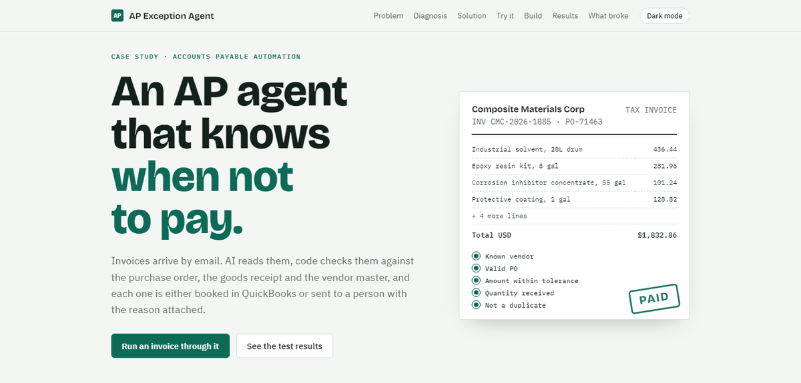
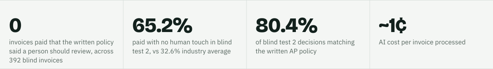

<p>
<a href="https://ebrahimtahirr.github.io/ap-agent-site/">
<picture>
  <source media="(prefers-color-scheme: dark)" srcset="assets/btn-case-study-dark.svg">
  
</picture>
</a>
</p>

**Live site:** [https://ebrahimtahirr.github.io/ap-agent-site/](https://ebrahimtahirr.github.io/ap-agent-site/)

<a href="https://ebrahimtahirr.github.io/ap-agent-site/">
<picture>
  <source media="(prefers-color-scheme: dark)" srcset="assets/hero-dark.png">
  
</picture>
</a>

<picture>
  <source media="(prefers-color-scheme: dark)" srcset="assets/stats-dark.svg">
  
</picture>

## What this is

The case study for the **AP Exception Agent**, an n8n and Claude agent that reads emailed supplier invoices, checks them against purchase orders, goods receipts and a vendor master, books the clean ones in QuickBooks (sandbox) and sends every exception to a person with the reason attached.

The site walks through the problem, the written policy, the design (code for facts, AI for judgment), a live demo of seven real invoices from the blind tests, the build and its regression gate, the results of two blind tests, what broke and what is still open.

## Stack

Vite, React, TypeScript, Tailwind CSS and Framer Motion. A static site with no backend, prerendered so every section reads without JavaScript, deployed to GitHub Pages with GitHub Actions.

## Tested

Playwright tests cover every section, the tolerance calculator, the pipeline, all seven demo outcomes, light and dark themes and the 390 px layout. Lighthouse on the live site: accessibility, best practices and SEO 100; performance 97 on mobile and 98 on desktop.

## How to run

```bash
npm install
npm run dev        # development
npm run build      # typecheck, build and prerender into dist/
npm run preview    # http://localhost:4173/ap-agent-site/
npx playwright install chromium && npm test
```

All invoices, vendors and companies shown are synthetic. QuickBooks sandbox only.
